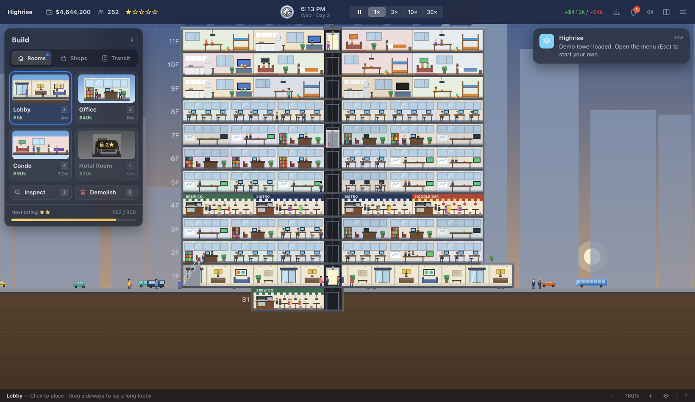
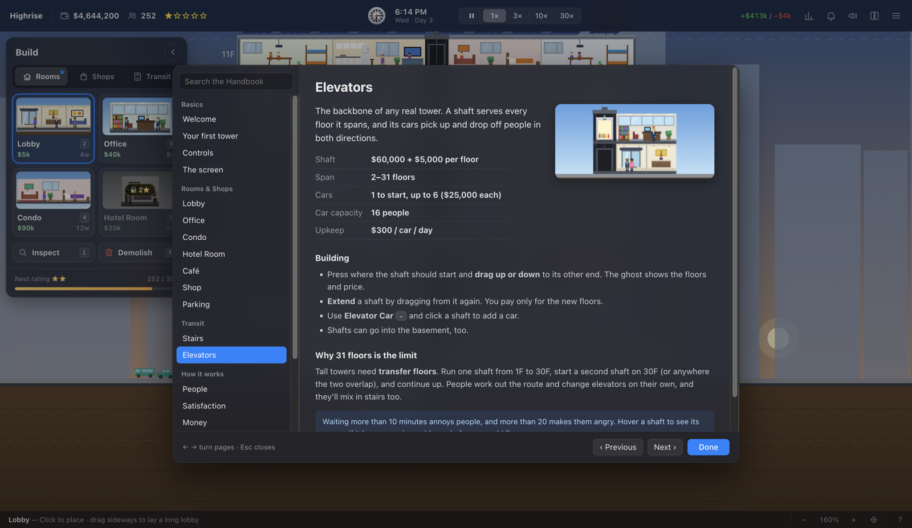
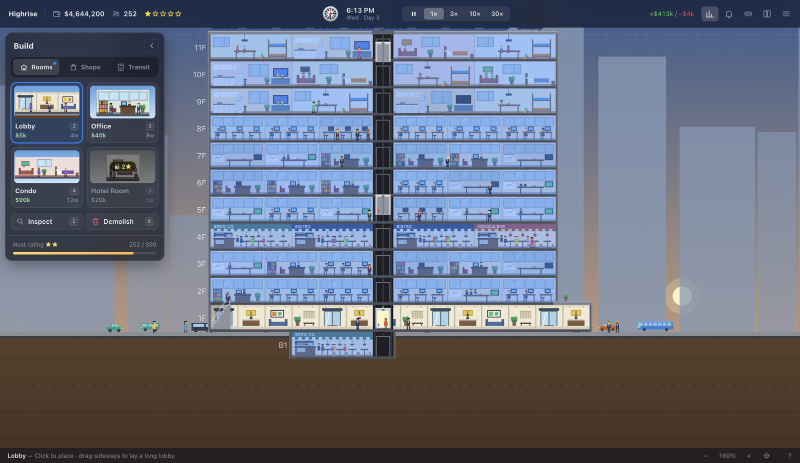

# Highrise

A modern-day, SimTower-style tower-building sim. Lay a lobby, stack offices, condos, hotels and shops,
and keep the elevators moving. Every person in your tower has a schedule, and slow commutes drive tenants out.

Runs on **macOS, Windows and Linux / Steam Deck**, with full mouse, keyboard and gamepad support.



## Download

Get the latest build from the **[Releases page](https://github.com/dbrudner/highrise/releases/latest)**:

| Platform | File |
| --- | --- |
| macOS (Apple Silicon) | `Highrise-<version>-arm64.dmg` |
| Windows 10/11 (64-bit) | `Highrise-Setup-<version>.exe` (installer) or `Highrise-<version>-win-x64.zip` (portable) |
| Linux / Steam Deck | `Highrise-<version>-linux-x86_64.AppImage` |

### Installing

**macOS.** Open the `.dmg` and drag Highrise into Applications. The build isn't notarized yet, so the first time,
**right-click the app → Open → Open**. (On macOS 15+, if that doesn't offer Open, go to System Settings →
Privacy & Security and click **Open Anyway**.)

**Windows.** Run the installer. It's unsigned for now, so SmartScreen may say "Windows protected your PC".
Click **More info → Run anyway**. The portable `.zip` needs no install: unzip it and run `Highrise.exe`.

**Steam Deck.**
1. Switch to **Desktop Mode** (Steam button → Power → Switch to Desktop).
2. Download the `.AppImage` (e.g. in Firefox) and move it somewhere permanent, like `~/Games/`.
3. Right-click it → **Properties → Permissions → Is executable**.
4. In Steam (desktop), **Games → Add a Non-Steam Game to My Library** → Browse → pick the AppImage.
5. Return to **Gaming Mode** and launch Highrise from your library. It opens full screen with controller support.

**Linux.** `chmod +x Highrise-*.AppImage && ./Highrise-*.AppImage`

**Browser.** No install needed if you build from source: see [Building](#building-from-source).

## How to play

The full manual is built into the game. Press **F1** (or **R3** on a controller), or pick **Handbook** from
the menu. You can read the same manual online in the **[Player Guide](docs/GUIDE.md)**.

The short version:

1. Drag a **Lobby** along the ground floor. Everyone enters and leaves through it.
2. Build **Offices** above it, and connect the floors with **Stairs** or an **Elevator** (drag up from the lobby).
3. Tenants move in, workers commute, and rent arrives at midnight.
4. When people get pink or red bubbles, their trips are too slow. Add elevator cars before they move out.
5. Population earns stars: **300 → ★★, 1,000 → ★★★, 2,500 → ★★★★, 5,000 → ★★★★★**. Stars unlock taller floors and new room types.

| | Mouse & keyboard | Gamepad / Steam Deck |
| --- | --- | --- |
| Build, drag to paint a row | Click / drag | **A** (hold to drag) |
| Move cursor | Mouse | Left stick |
| Pan | Right-drag, WASD | Right stick |
| Zoom | Scroll | LT / RT |
| Switch tool | 1–0, -, X | LB / RB, D-pad ← → |
| Pause / speed | P | Y / D-pad ↑ ↓ |
| Evaluation overlay | E | View |
| Back / menu | Esc | B / Menu |
| Handbook | F1 | R3 |

Saves are automatic (every in-game day and on quit). See [Saving](docs/GUIDE.md#saving) for where they're stored.

<p align="center"> </p>

## Building from source

Needs Rust with the `wasm32-unknown-unknown` target (`rustup target add wasm32-unknown-unknown`) and
Node 22.12+ for the desktop app.

```sh
./build.sh                              # cargo build → web/highrise.wasm
python3 -m http.server -d web 8080      # play in a browser at http://localhost:8080
                                        # (http://localhost:8080/#demo loads a sample tower)
```

Desktop app (Electron):

```sh
cd desktop && npm install
npm start              # run in a window
npm run dist:mac       # → dist/Highrise-<version>-arm64.dmg   (dist:mac-universal for Intel + Apple Silicon)
npm run dist:win       # → dist/Highrise-Setup-<version>.exe + portable zip
npm run dist:linux     # → dist/Highrise-<version>-linux-x86_64.AppImage (Steam uses dist/linux-unpacked)
npm run dist:all       # all of the above; everything cross-builds from a Mac
```

Tests: `node tools/smoke.mjs` and `node tools/stress.mjs` run the simulation headless against the built wasm.
`HIGHRISE_SMOKE=/tmp/shot.png npm start` renders the app off-screen, saves screenshots and quits.

See [`desktop/STEAM.md`](desktop/STEAM.md) for Steam integration (achievements, cloud saves, depots, Steam Deck review).

### Project layout

- `src/lib.rs`: the simulation (tenants, people, elevator dispatch, routing, economy). It's Rust compiled to
  WebAssembly with no dependencies, and exposes a small C ABI (`step`, `place`, `place_elevator`, `bulldoze`,
  zero-copy render buffers, `save_state`/`load_state`).
- `web/main.js`: input (mouse, touch, gamepad), HUD, menus and Canvas 2D rendering.
- `web/handbook.js`: the in-game Handbook. Costs and unlocks are read from the wasm. Rules text mirrors
  `src/lib.rs`, so update both together, then run `node tools/export-handbook.mjs` to regenerate `docs/GUIDE.md`.
- `web/audio.js`: synthesized music, ambience and sound effects.
- `desktop/`: Electron shell for macOS, Windows and Linux, with optional Steam support via steamworks.js.

## License

Copyright © 2026 Dave Brudner. All rights reserved. The source is public to read, but it isn't licensed for
reuse or redistribution.
